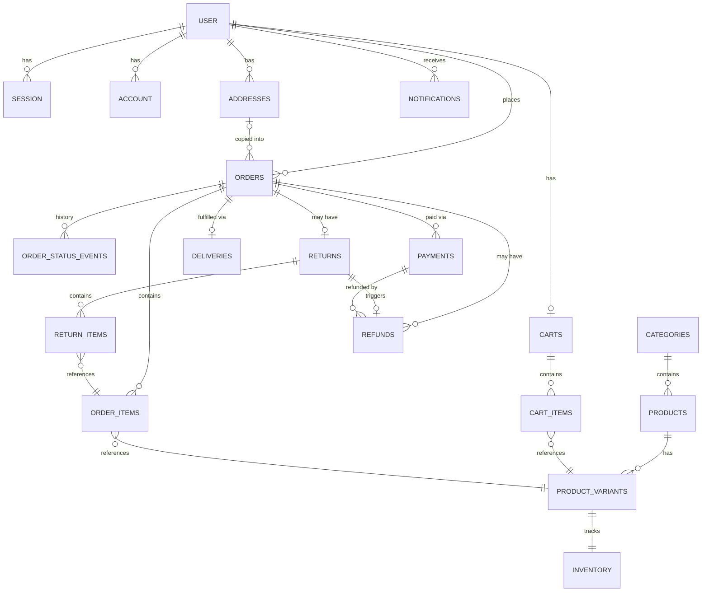

# Database Schema

Postgres (Neon, serverless), managed via Drizzle ORM. This document is the planned schema. Nothing has been built yet. It follows the Operations & Business Flow Spec and the API Specification.

## Entity Relationship Diagram

A cart belongs to a user **or** a guest (`carts.guestId`), so the `USER ||--o| CARTS` relationship is optional on the cart side too.

---

## Core tables

### `user` *(better-auth core + custom fields)*
| Column | Type | Notes |
|---|---|---|
| id | text | better-auth-generated UUID string — not native `uuid` |
| email | text, unique | |
| fullName | text | mapped from better-auth's core `name` |
| phone | text | |
| role | text | `customer` \| `admin`, default `customer`, `input: false` |
| emailVerified | boolean | |

### `session`, `account`, `verification`
better-auth standard tables — structure dictated by the library. `verification` also stores password-reset tokens. The bearer plugin (for mobile) needs no extra tables.

### `rate_limit`
| Column | Type | Notes |
|---|---|---|
| id | text | |
| key | text | |
| count | integer | |
| lastRequest | **bigint** | must be `bigint`, not `timestamp` — better-auth writes a raw ms number |

### `categories`
| Column | Type |
|---|---|
| id | uuid |
| name | varchar |
| slug | varchar, unique |

### `products`
| Column | Type | Notes |
|---|---|---|
| id | uuid | |
| categoryId | uuid, FK → categories | nullable |
| name | varchar | |
| slug | varchar, unique | storefront URL key (`/products/{slug}`); generated from `name` if not supplied |
| description | text | nullable |
| basePrice | numeric(10,2) | |
| isActive | boolean | default `true` |
| createdAt / updatedAt | timestamp | needed for `sort=newest` |

### `product_variants`
| Column | Type | Notes |
|---|---|---|
| id | uuid | |
| productId | uuid, FK → products, cascade delete | |
| size | varchar | |
| color | varchar | |
| priceOverride | numeric(10,2) | nullable |
| imageUrl | text | nullable — a Vercel Blob URL from the admin upload endpoint |
| isActive | boolean, default `true` | lets a single variant be retired without deleting it (`order_items` and `cart_items` reference it) |

Unique on `(productId, size, color)`.

### `inventory`
| Column | Type |
|---|---|
| id | uuid |
| variantId | uuid, FK → product_variants, unique |
| quantity | integer, `CHECK (quantity >= 0)` |
| lowStockThreshold | integer, default 5 |

The `CHECK` is a last line of defence: even if application logic is wrong, the database refuses to oversell.

### `addresses`
| Column | Type | Notes |
|---|---|---|
| id | uuid | |
| userId | text, FK → user, cascade delete | |
| recipientName | varchar | who receives the parcel (may not be the account holder) |
| region | varchar | |
| city | varchar | |
| landmarkOrGps | varchar, nullable | |
| recipientPhone | varchar | |
| isDefault | boolean | |
| isArchived | boolean, default `false` | "deleted" addresses are archived, not removed |

### `carts`
| Column | Type | Notes |
|---|---|---|
| id | uuid | |
| userId | text, FK → user, cascade delete, unique, nullable | null for a guest cart |
| guestId | text, unique, nullable | random UUID from the `guest_id` cookie / `X-Guest-Id` header |
| createdAt | timestamp | |
| updatedAt | timestamp | the guest-cart cleanup cron deletes guest carts not updated in 30 days |

`CHECK ((userId IS NULL) <> (guestId IS NULL))` — exactly one owner. Enforced in the database, not only in application code, because the merge logic is new and untested.

### `cart_items`
| Column | Type |
|---|---|
| id | uuid |
| cartId | uuid, FK → carts, cascade delete |
| variantId | uuid, FK → product_variants |
| quantity | integer, default 1, `CHECK (quantity >= 1)` |

Unique on `(cartId, variantId)` — the database-level guarantee behind "add to cart increments, never duplicates."

### `orders`
| Column | Type | Notes |
|---|---|---|
| id | uuid | |
| userId | text, FK → user | |
| addressId | uuid, FK → addresses, nullable, on delete set null | kept only as a reference to the address the customer picked; the order never reads shipping details from it |
| shippingRecipientName | varchar | copied from the address at checkout |
| shippingRecipientPhone | varchar | copied |
| shippingRegion | varchar | copied |
| shippingCity | varchar | copied |
| shippingLandmarkOrGps | varchar, nullable | copied |
| status | enum: `pending`, `paid`, `processing`, `shipped`, `delivered`, `cancelled` | |
| paymentMethod | enum: `paystack`, `manual_momo` | chosen at checkout; decides the expiry window and which payment flow applies |
| subtotal | numeric(10,2) | sum of line totals |
| deliveryFee | numeric(10,2), default `0.00` | `0.00` until delivery pricing is decided; refunds exclude it |
| totalAmount | numeric(10,2) | `subtotal + deliveryFee` |
| currency | char(3), default `'GHS'` | |
| idempotencyKey | text | from the `Idempotency-Key` header; unique on `(userId, idempotencyKey)` |
| expiresAt | timestamp | `pending` orders past this are cancelled and their stock restored |
| paidAt | timestamp, nullable | |
| cancelledAt | timestamp, nullable | |
| cancellationReason | text, nullable | free text, or `expired` for automatic expiry |
| cancelledBy | enum: `customer`, `admin`, `system`, nullable | |
| cancelledByAdminId | text, FK → user, nullable | |
| createdAt / updatedAt | timestamp | |

Index on `(status, expiresAt)` for the expiry cron.

### `order_items`
| Column | Type |
|---|---|
| id | uuid |
| orderId | uuid, FK → orders, cascade delete |
| variantId | uuid, FK → product_variants |
| productName, size, color | varchar — snapshotted at order time |
| imageUrl | text, nullable — snapshotted at order time, so order history still shows a picture if the variant image changes |
| unitPrice | numeric(10,2) — snapshotted at order time |
| quantity | integer |

### `payments`
| Column | Type | Notes |
|---|---|---|
| id | uuid | |
| orderId | uuid, FK → orders, cascade delete | |
| provider | enum: `paystack`, `flutterwave`, `manual` | `manual` = business MoMo number, admin-confirmed |
| providerReference | varchar, unique when not null | Paystack transaction reference, or the MoMo transaction reference for manual payments |
| status | enum: `pending`, `success`, `failed`, `amount_mismatch` | `amount_mismatch`: Paystack reported success but for a different amount/currency than the order; the order is not advanced |
| amount | numeric(10,2) | |
| currency | char(3), default `'GHS'` | |
| paidAt | timestamp, nullable | |
| markedByAdminId | text, FK → user, nullable | required when `provider = "manual"`; records which admin confirmed it |
| markedAt | timestamp, nullable | when the manual confirmation happened |
| note | text, nullable | optional admin note |
| createdAt | timestamp | |

One order may have several `payments` rows (each Paystack retry gets its own reference), but at most one with `status = 'success'` — enforce with a partial unique index on `(orderId) WHERE status = 'success'`.

---

## Order lifecycle tables

### `order_status_events` — order history / audit trail
| Column | Type | Notes |
|---|---|---|
| id | uuid | |
| orderId | uuid, FK → orders, cascade delete | |
| fromStatus | order status enum, nullable | null for creation |
| toStatus | order status enum | |
| actor | enum: `customer`, `admin`, `system`, `paystack` | |
| actorAdminId | text, FK → user, nullable | |
| note | text, nullable | |
| createdAt | timestamp | |

Written in the same transaction as every order status change. Backs the admin order timeline and answers "who changed this and when" without guessing from `updatedAt`.

### `webhook_events` — webhook idempotency
| Column | Type | Notes |
|---|---|---|
| id | uuid | |
| provider | varchar | `paystack` |
| eventId | varchar | provider's event identifier (for Paystack: `data.id` + `event` type) |
| eventType | varchar | e.g. `charge.success` |
| payload | jsonb | raw payload, kept for debugging and replay |
| processedAt | timestamp | |

Unique on `(provider, eventId)`. Inserted in the same transaction as the event's effects, so a duplicate delivery fails the insert and is skipped.

### `deliveries` — one active delivery per order
| Column | Type | Notes |
|---|---|---|
| id | uuid | |
| orderId | uuid, FK → orders | |
| provider | varchar, nullable | dispatch company name (e.g. "Shaq Express") — plain string, not an enum, since no provider is confirmed yet |
| providerReference | varchar, nullable | the courier/tracking reference from the provider |
| status | enum: `requested`, `assigned`, `picked_up`, `en_route`, `delivered`, `failed`, **`cancelled`** | `cancelled` when the order is cancelled or moved back to `processing` |
| currentLat | numeric, nullable | reserved for a future provider that supports live location — unused today |
| currentLng | numeric, nullable | reserved, unused today |
| requestedAt | timestamp | |
| deliveredAt | timestamp, nullable | **start of the 14-day return window** |
| failureReason | text, nullable | required when status is `failed` |
| updatedAt | timestamp | |

Partial unique index on `(orderId) WHERE status <> 'cancelled'` — at most one active delivery per order (no split shipments), while still allowing a new one after a courier request falls through. A `deliveries.status = "delivered"` event is what advances `orders.status` to `delivered`.

### `returns` — one per order, ever (one-shot)
| Column | Type | Notes |
|---|---|---|
| id | uuid | |
| orderId | uuid, FK → orders, **unique** | one return attempt per order, ever — a rejected return cannot be retried |
| status | enum: `return_requested`, `return_approved`, `return_rejected`, `return_received`, `return_rejected_on_inspection`, `refund_pending`, `refund_initiated`, `refunded` | `refund_pending`: inspection passed, waiting for an admin to start the refund. `refund_initiated`: refund sent to Paystack, waiting for its confirmation |
| reason | text, nullable | customer-provided, optional |
| rejectionReason | text, nullable | admin-provided; shown to the customer whenever status is `return_rejected` or `return_rejected_on_inspection` |
| requestedAt | timestamp | |
| decidedAt | timestamp, nullable | when admin approved/rejected the request |
| decidedByAdminId | text, FK → user, nullable | |
| receivedAt | timestamp, nullable | when the item was confirmed received |
| inspectedAt | timestamp, nullable | |
| inspectedByAdminId | text, FK → user, nullable | |
| restocked | boolean, default `false` | whether returned units were added back to inventory on inspection |

Must be within 14 days of `deliveries.deliveredAt` (enforced at the application layer) for a return to be created at all.

### `return_items` — supports partial returns
| Column | Type | Notes |
|---|---|---|
| id | uuid | |
| returnId | uuid, FK → returns, cascade delete | |
| orderItemId | uuid, FK → order_items | the exact purchased item (price/size/color snapshot) |
| quantity | integer, `CHECK (quantity >= 1)` | may be less than the original `order_items.quantity` (upper bound checked in the application) |

Unique on `(returnId, orderItemId)`.

### `refunds` — separate from `payments`
| Column | Type | Notes |
|---|---|---|
| id | uuid | |
| orderId | uuid, FK → orders | |
| returnId | uuid, FK → returns, nullable | set when the refund came from a return; null for cancellation / late-payment refunds |
| paymentId | uuid, FK → payments | the original payment being refunded; its `provider` decides whether the refund goes through Paystack or is recorded manually |
| reason | enum: `cancellation`, `return`, `late_payment` | why the refund exists |
| amount | numeric(10,2) | **excludes delivery fee** |
| currency | char(3), default `'GHS'` | |
| status | enum: `pending`, `initiated`, `completed`, `failed` | `pending`: created, no money moved yet, waiting for an admin |
| paystackRefundReference | varchar, nullable, unique | |
| manualReference | varchar, nullable | MoMo reference when a manual payment is refunded by hand |
| failureReason | text, nullable | from Paystack's `refund.failed` |
| initiatedByAdminId | text, FK → user, **nullable** | null while `pending`; set when an admin starts the refund — refunds never move money without one |
| createdAt | timestamp | when the refund row was created (cancellation, inspection, etc.) |
| initiatedAt | timestamp, nullable | |
| completedAt | timestamp, nullable | set when Paystack's webhook confirms, or when a manual refund is recorded |

`CHECK (status = 'pending' OR initiatedByAdminId IS NOT NULL)` — no refund can reach `initiated`/`completed`/`failed` without an admin attached.

### `notifications` — persisted, admin-facing
| Column | Type | Notes |
|---|---|---|
| id | uuid | |
| recipientAdminId | text, FK → user, nullable | null = broadcast to all admins |
| type | enum: `new_order`, `return_requested`, `delivery_failed`, `refund_pending`, `refund_failed`, `payment_issue` | extensible |
| relatedOrderId | uuid, FK → orders, nullable | |
| relatedReturnId | uuid, FK → returns, nullable | |
| relatedRefundId | uuid, FK → refunds, nullable | |
| message | text | |
| isRead | boolean, default `false` | |
| createdAt | timestamp | |

---

## Notable schema decisions

- **Orders copy the shipping address** instead of reading it through `addressId`. An address the customer edits or archives later must not change where a past order says it shipped. This is the same reasoning as `order_items` copying price and product data.
- **Unpaid orders expire** (`orders.expiresAt`). Stock is reserved at checkout, so without an expiry every abandoned checkout would hold its stock forever.
- **`refunds` is separate from `payments`.** A payment and its refund are separate financial events with their own timestamps and statuses. Storing them as one row with a changing status would lose the record of what was originally paid.
- **Refunds start as `pending` and need an admin to move money.** Cancellations and passed inspections only create the row. The database `CHECK` on `initiatedByAdminId` backs up the rule that refunds are always admin-triggered.
- **`payments.provider = "manual"` requires `markedByAdminId` + `markedAt`** at the application layer. Every manual payment confirmation must be traceable to a specific admin.
- **At most one successful payment per order** (partial unique index). Combined with `webhook_events`, this means a duplicate webhook or a webhook racing the verify call can't record a payment twice.
- **`deliveries` allows one active row per order; `returns` is unique per order.** No split shipments, and only one return attempt per order. A cancelled delivery can be replaced.
- **`return_items` exists even though v1 UI may only support whole-order returns.** Building the correct data model now is cheaper than migrating once real return records exist.
- **`deliveries.provider` is a plain string, not an enum.** No dispatch provider is confirmed yet.
- **`deliveries.currentLat`/`currentLng` exist but are unused.** They're reserved for a future provider that exposes live location.
- **`user.id` is `text`, not native `uuid`.** This comes from better-auth's ID generation, and every FK to `user.id` uses `text` too.
- **`rate_limit.lastRequest` is `bigint`, not `timestamp`.** better-auth writes it as a raw millisecond number.
- **Money is `numeric(10,2)` in cedis everywhere.** Pesewas exist only at the Paystack API boundary.
- **Database `CHECK`s back up the critical rules**: no negative stock, exactly one cart owner, no admin-less refunds. The application enforces these too. The checks are there for when application code is wrong.

## Open questions affecting this schema

- Confirmed dispatch provider. This decides whether `deliveries.provider` stays a free string or becomes an enum.
- Whether items rejected on inspection are shipped back to the customer, and at whose cost. A "return shipment" may need its own status or column.
- Delivery pricing (flat, per region, or provider-quoted). `orders.deliveryFee` exists but is always `0.00` until this is decided.